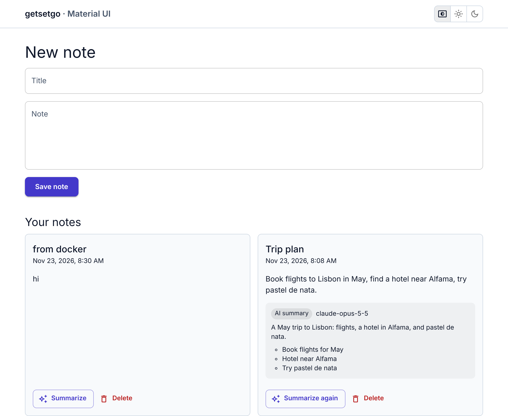
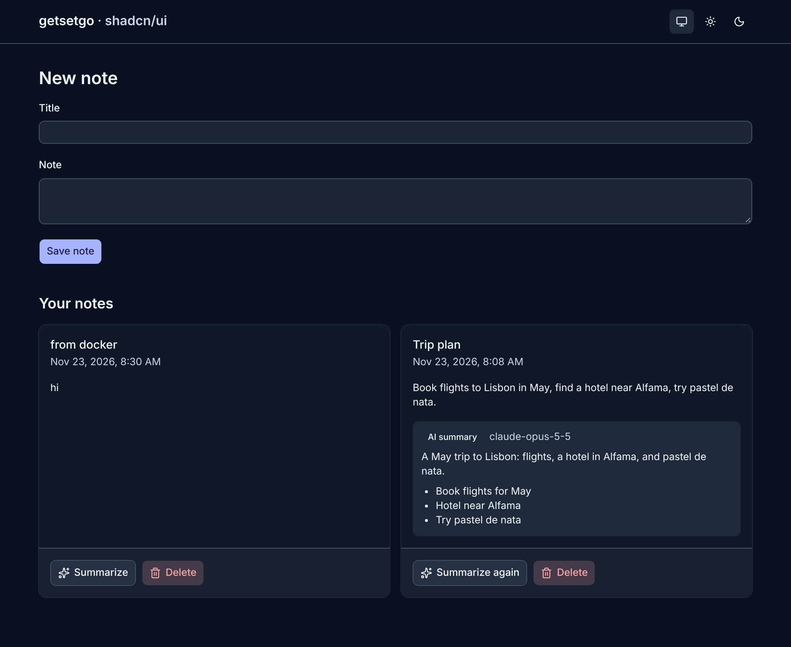

# Frontends: `apps/web-material` and `apps/web-shadcn`

Two Next.js 16 apps with the **same features and accessible names**, built on two different
stacks so you can compare them side by side.

|             | `apps/web-material` (port 3000)                     | `apps/web-shadcn` (port 3001)                                               |
| ----------- | --------------------------------------------------- | --------------------------------------------------------------------------- |
| Components  | Material UI 9 (Emotion)                             | shadcn/ui on Radix + Tailwind CSS 4                                         |
| Server data | Apollo Client (`PreloadQuery` → `useSuspenseQuery`) | TanStack Query (`prefetchQuery` → `HydrationBoundary` → `useSuspenseQuery`) |
| UI state    | Redux Toolkit (theme, snackbar)                     | Zustand (theme)                                                             |
| Forms       | Formik + Yup                                        | React Hook Form + Zod                                                       |
| Toasts      | MUI `Snackbar` + `Alert`                            | sonner                                                                      |
| Dark mode   | MUI CSS variables, `.light`/`.dark` on `<html>`     | Shared tokens CSS, `data-theme` on `<html>`                                 |




## Run them

```bash
pnpm infra:up
```

```bash
pnpm dev
```

`pnpm dev` starts all four apps: the API (4000), the AI service (8000), web-material
(http://localhost:3000) and web-shadcn (http://localhost:3001).

## How a page loads

```
browser ──GET /──▶ Next.js (proxy.ts: nonce + CSP) ──▶ server render
                                                        │ fetch notes from API_URL directly
                                                        ▼
                     HTML with the notes + data handed to Apollo/TanStack cache
browser ──POST /api/graphql──▶ Next.js rewrite ──▶ API (same origin, no CORS)
```

- **Server prefetch, client hydrate:** the server fetches the notes and streams them into the
  client library's cache. The browser makes **no** API call on load; mutations then run in the browser.
- **Same-origin API:** the browser only talks to its own app at `/api/graphql`, which Next.js forwards
  to `API_URL` (`next.config.ts` rewrites). Auth cookies will stay first-party, and the API address stays private.
- **Shared code:** typed GraphQL operations (`packages/graphql`, generated with GraphQL Codegen from
  `apps/api/schema.graphql`), design tokens (`packages/ui-tokens`) and security headers (`packages/web-security`).

## Security: strict nonce CSP

Every page gets a fresh nonce from `src/proxy.ts`; scripts and `<style>` tags without it are blocked
(OWASP A03/A05). Things this required, each noted in the code:

- **Cache Components / Partial Prerendering are off.** A prebuilt page shell can't carry a
  per-request nonce (the Next.js docs say PPR is incompatible with nonce CSP). Every page renders per request.
- **Nonce passed to libraries** that add tags at runtime: MUI's Emotion cache, MUI's
  `InitColorSchemeScript`, Apollo's SSR data transport (`extraScriptProps`), Radix's scroll lock (`get-nonce`).
- **sonner is patched** (`patches/sonner@2.0.8.patch`) to stop injecting a `<style>` tag; its
  stylesheet is imported normally instead.
- **Zod runs in `jitless` mode**, since its fast path uses `new Function` (eval).
- **Development only:** the Next dev server injects CSS without a nonce, so `style-src` allows
  inline styles in dev. Scripts are nonce-only in every mode.

Also: HSTS (production), `X-Frame-Options: DENY`, `nosniff`, a strict `Referrer-Policy` and `Permissions-Policy`.

## Accessibility (WCAG 2.2 AA)

- The palette is contrast-tested in light and dark (`packages/ui-tokens` tests).
- Skip link, landmark regions, labelled sections, visible focus rings, 40 px targets, reduced motion.
- Form errors are linked to their fields (`aria-invalid` + `aria-describedby`) and announced.
- The delete confirmation is an `alertdialog` that opens with focus on **Cancel**.
- **Hydration safety:** "Save note" stays disabled until React is running, because a native
  submit before hydration would reload the page with the note text in the URL. The Formik form
  also adopts text typed before hydration, which controlled inputs would otherwise wipe.

## Tests

| Command                                                       | What runs                                                                  |
| ------------------------------------------------------------- | -------------------------------------------------------------------------- |
| `pnpm --filter @getsetgo/web-shadcn test` (or `web-material`) | Vitest + Testing Library: schemas, store, form behavior                    |
| `pnpm test:e2e`                                               | Builds both apps, then runs the shared Playwright + axe suite against each |

The e2e suite (`packages/e2e`) needs the API running (`pnpm infra:up && pnpm stack:up`, or `pnpm dev`)
and a browser (`pnpm --filter @getsetgo/web-shadcn exec playwright install chromium`, once).
Every test fails on any CSP violation or console error, and axe checks WCAG 2.2 AA in light and dark mode.

## Changing things

- **New query or mutation:** add it to `packages/graphql/src/operations/*.graphql`, then
  `pnpm --filter @getsetgo/graphql codegen`. If the API schema changed, start the API in dev first so
  `apps/api/schema.graphql` is regenerated.
- **New shadcn component:** `cd apps/web-shadcn && pnpm dlx shadcn@latest add <name>`.
- **Colors:** edit `packages/ui-tokens/src/index.ts` **and** `tokens.css`; the tests check they
  match and that contrast still passes.
- **Stack boundaries:** web-material's lint config blocks web-shadcn's libraries (constitution II).
